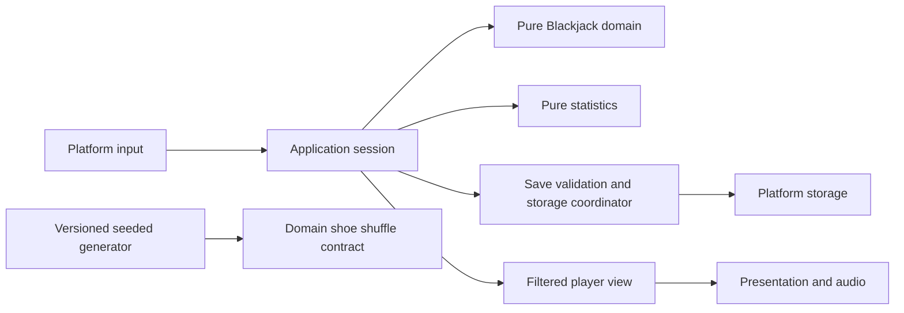

# ARCHITECTURE

**Status:** native preview.4 polish implemented; new-artifact device approval pending. **Revision:** 4. **Research date:** 2026-10-01; polish update 2026-10-02.

The owner reports preview.3 launched and normal Blackjack worked on RG35XX H/muOS through PortMaster, then explicitly authorized the final learning/audio/focus polish. The shared engine, approved rules, native save protocol and packaging route remain in place. The technology comparison and future platform gates remain applicable. [FINAL_VERIFICATION](../artifacts/polish-evidence/FINAL_VERIFICATION.md) records the new artifact's checks; its device QA remains pending and no Web/Android compatibility is claimed.

## Technology decision

**Recommendation: LÖVE + Lua for the initial handheld product, conditional on the compatibility gates.** Use the portable Lua 5.1 language subset for the authoritative engine. Target the common API subset of the verified handheld, desktop, Android, and browser runtimes; select exact versions only after experiments.

This is an engineering judgment about a small turn-based game, not measured proof of lower memory or better speed. LÖVE makes responsibilities visible in ordinary text modules and avoids a scene/editor architecture for the domain. Its main cost is writing a modest UI layer and maintaining a less standardized Web route. Godot is a credible alternative, especially if official Web/Android tooling outweighs the handheld-first priority.

### Strongest realistic options

| Criterion | LÖVE + Lua | Godot + GDScript | raylib + C |
| --- | --- | --- | --- |
| RG35XX H / muOS route | PortMaster aarch64 route; owner reports preview.3 worked on the nominated device; preview.4 QA pending | Godot 3/FRT and Godot 4/Westonpack are distinct community routes; exports are not interchangeable | Native ARM/Linux DRM or appropriate SDL backend is plausible; exact H700 build/driver route unverified |
| 1 GB / ARM performance | Modest 2D workload is a plausible fit; measure runtime, asset memory, and pacing | Rich UI tooling, but engine/runtime overhead and graphics compatibility need measurement; published desktop minimum is above the device RAM | Strong control over memory and dependencies; more manual resource/error handling |
| 640×480 UI | Direct 2D drawing, explicit layouts; small focused widgets needed | Control nodes/layout/editor tooling can accelerate polish | Direct drawing; more manual widgets, focus and accessibility work |
| Controller | Framework joystick/gamepad events plus verified mapping; PortMaster fallback where required | Input actions useful; FRT-specific mapping limitations differ from desktop/Godot 4 | Library input plus platform/backend mappings; must test actual device |
| Web | Community love.js/Emscripten route, not official native export; persistence/audio/build risks | Official Web export; Godot 4 uses WebGL 2 Compatibility renderer, with browser caveats | Emscripten/WebAssembly route supported; build and browser glue still required |
| Android | Upstream Android embedding project; Gradle/SDK/NDK/signing knowledge still needed | Official APK/AAB export tooling; lifecycle and touch still require tests | Supported target, but more native packaging/toolchain work |
| Desktop | Straightforward local development route | Strong editor/debugger/export workflow | Supported native builds; compiler/CMake setup |
| Automated testing | Headless portable core under Lua 5.1/LuaJIT; small external test tools | Headless engine tests with chosen third-party test framework; typed GDScript supports warnings | Native test executables, compiler warnings, sanitizers; cross/WASM fixture runs |
| CI / analysis | Formatter + Lua static lint, explicit boundary checks; dynamic typing remains | Engine warnings/static typing where available, headless tests and exports | Strong compiler analysis/sanitizers, but a broader toolchain matrix |
| Save APIs | Framework filesystem is convenient; durability and browser persistence need adapters | `user://` and file APIs convenient; browser backend/durability still need validation | Mostly own file/IndexedDB glue; filesystem portability work |
| Packaging | Small game archive plus runtime; handheld launcher, Web wrapper and Android embedding differ | Export templates plus target-specific community handheld runtime | Native binaries per ABI plus libraries; Android/WASM build pipelines |
| Solo learning / maintainability | Small readable tables/functions; bugs from dynamic types mitigated by contracts/tests | Good tooling, but scenes/resources/signals can hide responsibilities unless disciplined | Small conceptual API, but C memory safety, ABI/build work increase learning load |
| Community / longevity | Mature native framework; browser and handheld maintainers are separate dependencies | Broad ecosystem and first-party exports; handheld forks/runtimes remain separate risks | Active low-level library; fewer conveniences, more project-owned infrastructure |

Do not adopt Unity, Unreal, a browser engine inside a handheld WebView, Kotlin/Compose as the universal game stack, or a custom SDL+Lua engine for this scope. These introduce significant runtime, platform, or engine-building work without solving the primary handheld constraint. SDL + C is feasible, but raylib is the clearer lightweight comparison because it supplies higher-level drawing functions.

### Evidence and uncertainty

PortMaster documents LÖVE, Godot/FRT and Westonpack routes and warns about limited graphics/display environments. That establishes candidate routes, not this game's compatibility. The linked LÖVE aarch64 build notes explicitly show 11.4; love.js describes an 11.5 Web port. Do not assume one unmodified runtime/version across targets or that “latest” is the correct handheld choice. Sources: [PortMaster porting guide](https://portmaster.games/porting.html), [LÖVE aarch64 build notes](https://github.com/Cebion/love2d_aarch64), [love.js maintainer documentation](https://github.com/Davidobot/love.js).

PortMaster's device record lists RG35XX H/muOS as H700, 640×480, 1024 MB, and aarch64. Record actual firmware and ABI in POC-01 rather than treating that registry as a device test. [PortMaster device metadata](https://github.com/PortsMaster/PortMaster-Info/blob/main/device_info.json).

Godot 4's published exported-project desktop minimum includes 2 GB RAM and an OpenGL 3.3 Compatibility path; this is a caution, not proof a constrained 2D game cannot work on 1 GB through a specialized route. Westonpack provides a Godot 4 route with compatibility layers and expressly does not guarantee compatibility. Godot 3/FRT is a separate older-engine option, with different APIs and runtime handling. Sources: [Godot system requirements](https://docs.godotengine.org/en/stable/about/system_requirements.html), [Westonpack maintainer wiki](https://github.com/binarycounter/Westonpack/wiki/).

Godot's official Web export is an advantage; Godot 4 targets WebGL 2 with Compatibility rendering and supports single-threaded export. raylib documents Android, HTML5, and native Linux without a window system, but that alone proves no H700 support. Sources: [Godot Web export](https://docs.godotengine.org/en/stable/tutorials/export/exporting_for_web.html), [raylib platform FAQ](https://github.com/raysan5/raylib/blob/master/FAQ.md).

LÖVE's upstream Android project describes embedded game APK/AAB builds; it is a packaging route, not a guarantee of current store acceptance or tested app lifecycle. love.js documents compatibility/threads/audio/header tradeoffs and build-toolchain constraints. Reproduce the Web build during POC-03 rather than accepting a precompiled demo as sufficient evidence. [LÖVE Android upstream](https://github.com/love2d/love-android), [love.js](https://github.com/Davidobot/love.js).

**Decision trigger:** if Web persistence/offline operation is unreliable, browser builds need a substantial engine fork, or handheld performance/control gates fail, stop and re-evaluate. Test a minimal Godot candidate on the nominated handheld. If both fail, evaluate raylib only after accepting its C/toolchain learning cost. Do not build two production engines or translate Blackjack into another language for the Web.

## Proposed repository layout

The tree below is the original responsibility plan, not a requirement to create every listed file. The preview implements Blackjack, progress, app, random, persistence, UI and native platform responsibilities. Small tests remain flat scenario files. App modules own focus/coordinator actions, local identity stays in `platform/native_storage`, and sequential save migrations are real; no browser adapter exists. The compact polish boundaries below add only approved advice, tutorial, coach and audio responsibilities. Create a module when its first approved responsibility is implemented.

```text
README.md
docs/
  PROJECT_SPEC.md
  BLACKJACK_RULES.md
  ARCHITECTURE.md
  CODING_STANDARD.md
  TEST_PLAN.md
  DEFINITION_OF_DONE.md
  LICENSING_DECISIONS.md
main.lua                       # Small LÖVE composition/callback entry point
conf.lua                       # Framework configuration only
src/
  blackjack/
    cards.lua
    hand.lua
    rules.lua
    chips.lua
    shoe.lua
    round.lua
    player_actions.lua
    dealer.lua
    settlement.lua
  progress/
    statistics.lua
  app/
    session.lua
    player_view.lua
  random/
    seeded.lua
  persistence/
    save_schema.lua
    save_store.lua
    migrations.lua             # Validated v1 → v2 → v3 memory migration
  ui/
    table_screen.lua
    menu_screen.lua
    focus.lua
  platform/
    love_input.lua
    native_storage.lua
    identity.lua
    browser_storage.lua        # At Web milestone
tests/
  unit/
  integration/
  fixtures/
  simulation/
assets/                        # Only cleared, attributable assets
packaging/                     # At distribution milestones
tools/                         # Only actual build/test helpers
.github/workflows/             # At implementation/CI milestone
LICENSE                        # After license decision
THIRD_PARTY_NOTICES.md          # At first third-party import
CHANGELOG.md                   # At first implementation/release changes
```

No universal `GameManager`, dependency-injection container, entity-component system, event bus, plugin registry, universal casino engine, database server, or repository/service hierarchy is needed. Plain module functions and a few explicit injected dependencies are enough.

## Dependency direction



Arrows represent dependencies or supplied values. Blackjack never imports the application, renderer, input, storage, or RNG implementation. The shoe accepts a small bounded-random function for shuffle; subsequent dealing reads the already ordered shoe. Statistics depend on finalized round summaries, not animation callbacks. Presentation reads a filtered view and submits commands through the session.

The learning benefit is direct: “Hit” means a domain command regardless of whether it came from A, a keyboard key, or a tap. A payout test requires no window, controller, OS, or Internet connection.

## Module responsibilities

Use these concise responsibilities in future module headers. Expanded implementation explanations belong in the code only when useful.

| Module | PURPOSE | CHANGE THIS MODULE WHEN | DO NOT PUT HERE |
| --- | --- | --- | --- |
| cards | Defines ranks, suits, physical IDs, deck construction | Card encoding or deck membership changes | Hand strategy, UI, payouts |
| hand | Evaluates totals, softness, bust, natural eligibility | Ace or natural evaluation changes | Drawing, bankroll mutation |
| rules | Validates supported rules and derives immutable profile identity | An approved rule/combination is added | UI widgets, silent defaults, RNG |
| chips | Bounded integer arithmetic and rational payout helpers | Chip unit/divisibility contract changes | Formatting currencies, game flow |
| shoe | Owns order, cursor, discards, cut and shuffle state | Construction/shuffle/penetration changes | Payouts, controls, graphics |
| round | Owns round phases, legal-action routing and active hand | Round sequencing or transition changes | File writes, animations, large helper collections |
| player_actions | Applies Hit/Stand/Double/Split under validated rules | Player action constraints change | Dealer loop, saves |
| dealer | Applies dealer draw/stop policy | S17/H17 or resolution draw policy changes | Player input, credits |
| settlement | Produces outcomes and explicit debit/return summary | Outcome precedence or payout changes | Randomness, UI, file writes |
| statistics | Reduces a completed/void round summary into counters | Metric definitions change | Animation counts, timestamps, wallet authority |
| session | Coordinates one command, domain result, stats and save acknowledgement | Lifecycle/commit ordering changes | Blackjack rule formulas, rendering |
| player_view | Removes hidden information and prepares readable state | Displayed visibility changes | Mutating engine state, trainer answers |
| seeded | Implements approved versioned deterministic RNG contract | PRNG algorithm/version changes | Settlement, time-based gameplay decisions |
| save_schema | Safe decoding, validation and plain-data snapshot conversion | Save fields/version change | File paths, cloud requests |
| save_store | Loads/recover/commits validated generations | Recovery/write ordering changes | Blackjack rules, UI decisions |
| platform adapters | Translate input or platform storage/identity calls | A target API changes | Game rules or duplicated engine logic |

## Domain state and command contract

Use plain, serializable tables with explicit fields. No engine objects, closures, userdata, metatable magic, animation state, absolute file paths, or OS handles in saved/domain state.

Core concepts are Card, Hand, Rules, Shoe, Round and chip amounts. A hand records cards, stake, split origin, ace restrictions, and status. A round records a stable round ID, opening bankroll, all hands, current hand, dealer cards and exposure, action/debit summary, and settlement status. Its rules remain immutable in `game.rules` until the next betting boundary. The full shoe lives once in session state; hands refer to physical card IDs. The preview's card catalog is a canonical mapping in `cards.lua`: rank/suit/deck are derived from IDs 1 through 52 × deck_count, so saves do not duplicate catalog objects.

Proposed stable phases: `betting`, `insurance_decision` only if that feature is approved later, `player_turn`, and `round_result`. Initial dealing, peek, dealer play and settlement are internal deterministic transitions, not animation-controlled phases. A command resolves automatic steps until the next genuine decision or result. Visual dealing may animate afterward without changing the already committed truth.

Commands carry explicit intent (`deal` with an opening bet, `hit`, `stand`, `double`, `split`, `next_round`, and between-round settings/shuffle). The engine validates phase, hand identity, rules, funds and card availability. Invalid commands return a reason with unchanged state. No random, save, timestamp, or animation side effects occur for rejected commands.

Proposed engine result: next state plus small structured results describing visible card reveals/actions/settlement. This is an ordinary return value, not event sourcing. The session evaluates a candidate state separately, validates it, computes any statistics, persists the candidate, then adopts it. UI and other code never mutate the authoritative tables directly. Avoid freezing/general immutable frameworks; explicit copies and limited ownership are sufficient for this small state.

Use a monotonic command sequence within a profile revision and a stable round ID for stale-input/duplicate detection. Serialize commands; a held button cannot commit two wagers while a save is pending. An old command addressed to a finished hand is rejected. Do not create network/idempotency infrastructure for local play.

## Determinism and reproducible bugs

- Prototype shuffle receives an injected generator with `algorithm_id = park_miller`, `version = 1`, initial seed and current state. Its documented multiplier 16807 and modulus 2147483647 are pinned in `src/random/seeded.lua`; rejection sampling avoids biased modulo range conversion. Known-answer vectors and ownership tests pass in desktop LuaJIT. Every arithmetic product stays below 2^46. This is reproducible entertainment randomness, not cryptography; independent generator review and cross-runtime POC-02 remain pending. Never promise matching sequences from platform `math.random` or different LÖVE builds.
- The bounded draw contract is `next_integer(minimum, maximum)`, inclusive and unbiased by conversion; rejection sampling avoids modulo bias. Fisher–Yates calls it only during shuffle.
- After shuffle, Hit/deal/Split consume the ordered shoe. Random calls do not appear in hand evaluation, legal actions, payouts or dealer decisions.
- Tests may supply a predetermined ordered partial shoe through an explicit fixture path. `[A♠, 10♥, K♦, 9♣]` produces player A+K and dealer 10+9 in the fixed P-D-P-D dealing order. No shuffle occurs for this fixture.
- Inject identity and clock values at the application boundary. Domain code never reads wall time. Traverse ordered lists explicitly; hash-table iteration order cannot control cards, settlement or replay results.
- Capture an opt-in debug bundle containing build/engine version, full rule values, original ordered shoe or checkpoint, RNG identity/state, opening bankroll and ordered accepted commands. A seed alone cannot reproduce a bug after an algorithm/rules change.
- Debug exports can reveal future cards and hidden cards; keep them separate from ordinary UI and sharing optional. No automatic upload or unlimited replay history.

Replay means identical accepted commands and identical **domain outputs**, not identical frame times or animation timing. Seeded randomness is suitable for reproducible entertainment/testing; it is not cryptographic authentication or a real-money fairness certification.

## Exact chip representation

Use integer chip units: **1 chip = 10 units**. Opening bets are whole chips under the approved table step. This represents half-chip 3:2/surrender/insurance amounts and fifth-chip 6:5 amounts exactly, without approving those disabled variants.

Example: 5 chips = 50 units. A 3:2 natural earns 50 × 3 / 2 = 75 units profit and returns 125 units total. Bankroll display becomes 7.5 chips profit or 12.5 chips return by string formatting, never by approximate monetary arithmetic.

Store payouts as numerator/denominator pairs such as 3/2, not decimal `1.5`. Require divisibility of `stake_units × numerator` by denominator before credit. Reject configurations that require finer units; do not round or quietly truncate. Never multiply/divide chip amounts by arbitrary decimal values.

Lua 5.1 normally stores numbers as double-precision values, so “integer” is a validated arithmetic discipline, not an assumed 64-bit integer type. Use integers only, reject NaN/infinity/fractions, and bound persisted amounts/counters/revisions at 10^12 in magnitude (bankroll/stakes/counters nonnegative; net totals may be signed). All supported single operations and bounded settlement intermediates must stay below 2^53; check products and aggregate sums **before** exceeding the configured bound. Do not depend on LuaJIT FFI int64, Lua 5.3 operators, JavaScript BigInt, or serializing cdata. [Lua 5.1 number model](https://www.lua.org/manual/5.1/manual.html#2.2).

For V0.1, reserve enough numeric headroom before a bet for the maximum possible approved round return (including four doubled hands); reject a transaction that could overflow bankroll or required statistics. Maximum-bound tests cover products, aggregates and revision exhaustion. Never silently cap winnings/counters. The practical ceiling is deliberately enormous for entertainment; raising it later is a schema/arithmetic decision.

For each round:

```text
ending_available = opening_available − total_committed_stakes + total_returns
round_net = total_returns − total_committed_stakes
```

Split debits one additional equal stake; Double debits one additional current stake. Returns are credited once, then escrow is closed. The result summary records each hand's stake, outcome and return, plus separate side-wager rows if approved. No helper conflates “return” and “profit.” Grants/resets are separate progress transactions, not Blackjack wins. Format at the presentation boundary with no cash symbol or redeemability implication.

## Statistics contract

Reduce a finalized round summary once, in the same committed snapshot as bankroll. No lifetime event store is required. Persist definitions/version with counters:

- `completed_rounds`: one per normally finished round, irrespective of split count.
- `settled_hands`: one per final player hand; a split replaces its parent, so that parent is not another settled hand.
- `wins`, `losses`, `pushes`, and future `surrenders`: mutually exclusive final-hand outcomes, summing to settled hands.
- `natural_blackjacks`: original eligible naturals only, including natural pushes; a subset, not another win category.
- `player_busts`: subset of losses; dealer bust does not make a player bust.
- `split_actions`, `double_actions`, and optional `hit_actions`: accepted actions in completed rounds, with definitions retained after resume.
- `main_staked_units`, `main_returned_units`, `main_net_units`: include added split/double stakes exactly once. Track insurance independently if later enabled.
- `void_rounds`: interrupted exhaustion rounds, excluded from settled-hand/win/action/net statistics.
- `chip_grants_units`: added refill amounts separate from gameplay net. Starting balance is separately identified.

Settings-only saves do not change play metrics. Natural rate uses eligible original completed rounds as its denominator; hand win rate uses settled hands. Avoid presenting aggregate results across varying rules as a house-edge estimate. V0.1 may keep aggregate totals plus the current rule profile; per-rule analytics are later scope, not an implied database.

## Save architecture

### Snapshot format

Use bounded, human-inspectable UTF-8 JSON, decoded as data only. Never deserialize executable Lua or use `load`/`loadstring`. The preview pins rxi/json.lua 0.1.2 at the commit/hash recorded in THIRD_PARTY_NOTICES, retaining its MIT license unchanged. Size/depth preflight and schema checks surround it; bounded integer/string round-trips are tested. No professional audit is claimed. Optional round/result fields are omitted rather than encoded as JSON null.

Version 1 logical fields:

| Field | Meaning |
| --- | --- |
| `format_version`, `game_id` | Save schema and product identity, separate from app version |
| `app_version`, `engine_version` | Diagnostic compatibility information, not migration authority |
| `profile_id` | Generated local 128-bit random player/profile identifier, preserved on legitimate import; not an account credential |
| `lineage_id`, `revision`, `parent_revision`, `parent_snapshot_hash` | Snapshot ancestry and branch identity; local revision alone is not a global clock |
| `writer_device_id` | Identifies writer installation; device's own ID is stored separately and regenerated on another installation |
| `created_at`, `updated_at` | UTC timestamps if clock available; metadata only, never ordering/settlement authority |
| `chip_unit_scale`, `starting_bankroll_units`, `game.bankroll_units`, `statistics.chip_grants_units` | Exact representation, available balance and grants |
| `statistics_version`, `statistics` | Defined counters and exact cumulative amounts |
| `settings`, `game.rules` | Supported settings and complete rule values/profile revision |
| `game.shoe`, `game.rng` | Canonical physical-ID order/cursor/discard prefix, cut position, shuffle flags, generator state/version |
| `game.phase`, `game.command_sequence`, `game.round_sequence`, `game.round` | Round omitted at betting boundary; otherwise complete committed active/result state with ID, stakes, opening balance, exposure and finalized result |

Profile IDs use adapter-provided randomness, not just timestamps; UUID-style random IDs are collision-resistant identifiers, not security tokens. Missing/incorrect clocks cannot prevent offline play.

Format 3 retains the real format-2 `training.strategy`, `training.counting` and `count_settings` fields and adds `assistance` preferences plus bounded `coach` evidence. Validated v1/v2 payloads migrate through sequential copies without changing original game/IDs/revision/hash or old statistics. Coach observations initialize empty: aggregate legacy statistics cannot reconstruct decisions or wager sequences. The first accepted format-3 transaction preserves exact source bytes in `backup_format_1.json` or `backup_format_2.json`, then uses the alternate A/B slot. Migration source, backup and recovery reads stay bounded to 1 MiB; different valid backups/recovery copies remain protected. No achievement, cloud or authentication objects are added.

Envelope: checksum algorithm identifier (`sha256` proposed), exact payload JSON bytes stored as a string, and checksum of those bytes. All authoritative metadata is inside the hashed payload. Hashing exact bytes avoids canonical-JSON disagreements. Verify checksum before decoding/validating the inner payload. Use existing runtime/library hashing at the adapter boundary; no homemade hash algorithm. Checksums detect accidental changes, not deliberate tampering or authenticity.

### Validation and migrations

Validate in this order: bounded file size (proposed hard limit 1 MiB, ordinary target under 256 KiB), envelope structure/checksum, JSON depth/array/string limits, product/schema version, numeric bounds/types, settings/rules, card membership/partitions, round-phase legality, bankroll/stake consistency, statistics relationships, RNG compatibility and revision ancestry.

Do not trust JSON decoder success as valid gameplay state. Production shoes contain all 52 × approved deck_count cards, each in exactly one ownership partition; card IDs, hand references and hidden-card exposure flags must agree. Results marked settled cannot retain unpaid escrow. Intermediate player-turn snapshots may legitimately have stakes deducted and no lifetime statistics yet.

Format version is independent of release version. Real sequential migrations (`v1 → v2 → v3`) validate input/output, preserve the original old-format source, write new output to the alternate slot only on an accepted transaction, and retain old data if anything fails. Repeated migration is idempotent. The app version is preview.4; engine version remains 1 because Blackjack semantics are unchanged.

Unknown newer versions must be preserved and blocked from normal writes. Do not reset them, downgrade them, or choose an older backup and overwrite the newer slot silently. Unknown rule/engine semantics in active rounds require an explicit compatible handler/migration before resume. Do not reinterpret an old live round using the new default rules.

### Native write/recovery protocol

Use two complete slots, `save_a.json` and `save_b.json`, in a writable user-data location outside the installed game archive. Only one writer per profile. Load both and select the highest validated revision in the same profile/lineage; reject unrelated candidates and explain any recovery. Equal revision with different hashes is a conflict, not a timestamp tie-break.

For each accepted play/progress transaction:

1. Build and validate a candidate from the last adopted state. Debit/settlement/statistics form one candidate; no partial files per subsystem.
2. Serialize and hash it. Write the **non-current slot**, leaving the known valid current slot intact. Where supported, use a same-directory temporary file, flush data, atomic replacement, and directory flush; test the actual adapter semantics.
3. Close/read back, verify checksum and full schema. Only acknowledge commit after the adapter's supported persistence operation succeeds.
4. Adopt the candidate and show newly dealt information/results. Retain the previous valid generation for recovery. No additional “current slot pointer” is necessary.

A/B slots are also the fallback when LÖVE exposes no tested atomic-replace/fsync primitive: a torn candidate loses to the still-valid previous generation. **Do not claim guaranteed sudden-power-loss durability from close/readback or A/B alone.** SD/controller/filesystem caches can defeat it; record process-crash and power-loss evidence separately. Add a small platform helper only if measured durability needs justify it; no core FFI dependency.

If commit fails, pause money-changing actions, retain the last valid state, report the error and allow retry. Manual export/import is deferred beyond this preview; opening/copying the save folder is available. If failure happened after a candidate may have reached storage, reread/reconcile slot hashes/revisions before retry; never double-debit/settle or continue with memory and disk disagreeing. Do not reveal a new card before its candidate is acknowledged. The small preview settings menu commits each explicit change immediately; batching can be considered after storage profiling. No per-frame saving.

Save each accepted domain decision (and its automatic consequences), not every animation frame. With OD-05 approval, quit/kill resumes the last valid committed player decision/result, including hidden hole, current hand, shoe and generator state. Restore a settled result as settled; statistics and bankroll are not reapplied. Offline files are editable, so this is consistency/recovery, not anti-cheat.

### Corruption, backups and reset

- If newest slot is invalid and previous is valid, load previous, report rollback to that revision, and retain the invalid bytes for diagnosis where storage allows.
- If both are invalid, preserve originals; offer backup import or an explicit new-profile/reset action. Never silently grant a new balance or claim to recover selected fields from a corrupt file.
- Retain a known-valid backup before migration and provide manual portable export/import. Validate imports before touching current slots; installation/device identity is not imported as the new device's own identity.
- Bound diagnostic copies (proposed three per profile) and report inability to preserve one. Do not delete the only originals to make space for a replacement.
- Refill policy comes from OD-04: when between rounds and available balance is below the table minimum, a manual free refill sets it to 1,000 chips, records exactly the added units, retains lifetime statistics, and starts a new shoe. No refill during a live round. Creating a wholly new profile is a distinct explicit action, with a new identity and preserved old files.

A manual restore/import starts a new lineage referencing the imported snapshot; do not pretend it is a newer descendant merely by increasing the local revision. Startup recovery can remain on the recovered lineage and parent hash, which makes divergence detectable later. This small metadata convention prevents future sync from trusting clocks or merging unrelated histories.

### Browser storage contract

The browser adapter uses persistent IndexedDB transactions or a **verified** persistent Emscripten filesystem bridge; in-memory MEMFS is insufficient. Default Emscripten filesystem operations can be synchronous while persistent browser synchronization is asynchronous, so successful virtual-file writes alone are not save completion. [Emscripten filesystem/persistence documentation](https://emscripten.org/docs/api_reference/Filesystem-API.html).

Load persistent data before enabling play. Commit a whole candidate and previous generation atomically where the backend supports it; wait for transaction/synchronization completion before adopting. Test quota, denied access/private mode, refresh, full browser restart, multiple tabs and origin changes. Use a single-writer lock/lease or reject a second active tab; do not permit last-writer-wins races.

Report when persistence is unavailable. An explicitly selected temporary guest session may continue without durable progress, with export where feasible; it must not display “saved.” Browser storage can be evicted/cleared and is tied to origin, so provide export/import and qualify guarantees. A later service worker caches required game/runtime assets for offline relaunch after one online installation; first visit still needs delivery. A browser cannot retrieve an uncached app offline.

## Cross-platform strategy

| Target | Shared | Adapter/packaging responsibility | Release evidence |
| --- | --- | --- | --- |
| RG35XX H / muOS | Same Lua core, rules, fixtures, assets and LÖVE presentation subset | Verified aarch64 runtime/graphics backend, controller mapping, launcher/exit, writable data path; package must not overwrite saves | Exact hardware/firmware play, save/relaunch/failure and budgets |
| Desktop development | Same engine and primary presentation | Keyboard/gamepad, desktop window/scaling, native user-data path; small `.love`/runtime or equivalent build | Windows/Linux smoke plus headless/integration tests |
| Web | Same source core and compatible presentation | love.js/Emscripten wrapper, touch/mouse/gamepad, IndexedDB, lifecycle, user-gesture audio, offline cache and host headers | Browser matrix, persistent restart, native save interchange, quota/temporary-mode tests |
| Android | Same source core and compatible LÖVE presentation | Upstream embedded APK, app identity/signing, app-private storage, pause/resume/kill, safe-area layout and touch | Signed install/update and real-device offline/recovery/touch tests |

Do not create a separate JavaScript Blackjack implementation or Kotlin payout engine. If LÖVE cannot satisfy a required platform, revisit the stack or build a presentation adapter around the same Lua engine only after a scoped decision. All adapters run the same domain fixture corpus. No Internet-dependent runtime download at play time; runtime acquisition/installation is separate, documented, and an offline install route must exist where redistribution permits.

Pin runtime/tool versions and download hashes after validation. The preview has established source-only `.love` and handheld builders, a Windows launcher and the owner-tested PortMaster route. Preserve the installed `portmaster-path.txt` override to `/mnt/mmc/MUOS/PortMaster`, the SD1 launcher/data split and saves outside `game.love`. No runtime binary is redistributed. Every new package still needs exact-artifact controller/audio/storage QA; prior launch evidence cannot approve changed content.

## Optional cloud compatibility, without implementation

Keep progress snapshots separate from storage location and account identity. A generated local profile is not authentication. A future optional adapter can queue acknowledged snapshots after local commits; network failures cannot block play or cause local rollback. Do not add an empty cloud adapter, network dependency, account UI or sync daemon now.

An eventual account attaches to existing local progress through a supported identity provider. Do not build password storage or homemade authentication. Provider choice, consent/privacy, retention/deletion, and sync protocols require a later specification.

Branch conflicts are unavoidable with offline devices. Preserve profile ID, lineage, writer, revision and parent snapshot hash now; timestamps are informational. Recommend whole-snapshot choose-local/choose-remote/fork conflict resolution with a preserved losing backup. **Never sum bankrolls, take the larger balance, add lifetime counters, or automatically combine active rounds.** Any incremental merge later needs real operation IDs/deduplication and its own design. V0.1 does not need a CRDT or append-only event database.

Separate source, assets, settings and save storage leaves room for legitimate paid themes or editions without introducing monetization infrastructure. Edition/runtime identity must not secretly change chip values, rules or save compatibility.

## Locked V0.1 trainer and presentation boundaries (2026-10-02)

The three experiences share `blackjack` rules/cards/shoe/round functions. `training/basic_strategy` reads only the active player hand and visible dealer upcard, requests shared legal actions, and returns advice. `training/hi_lo` observes public IDs, deduplicates within a generation and calculates the approved estimate/true count. Neither module controls the game. `training/practice` owns ephemeral, independently seeded exercises; normal cards, RNG and bankroll stay in the durable `app/session`.

`app/training` submits a single answer transaction through that same session, then exposes feedback only after save acknowledgement. `progress/training_statistics` owns separate counter relationships. Active drills are not saved; acknowledged stats and preferences are. `app/count_view` reconstructs normal exposure using prior-round discards and the displayed filtered cards, excluding current-round committed discards until actually shown. `ui/presentation` receives filtered before/after views after an accepted game save and never looks up hidden ranks. Menu/Home/trainers pause a normal reveal; only table confirmation can finish it.

`ui/training_screen` draws questions and controller count entry; it never decides correctness. Shared visual/audio modules cache fonts, felt, vector art, the supplied logo and generated short effects. `src/check.lua` remains the one pure plain-shape validation helper. The owner reports previous physical controller gameplay worked; the new focus, tutorial and coach routes still require device QA.

No event bus, second Blackjack engine, backend or generic trainer framework is introduced. `TRAINING_RULES` defines the unchanged count convention; `LEARNING_GUIDE` records the four deviation facts, profile restrictions and source-estimator caveat. `HANDHELD_TEST` identifies the sole polish candidate and next hardware gate. Web/Android architecture notes remain future planning.

## Authorized final polish boundaries

| Module | Responsibility |
| --- | --- |
| `app/assistance` | Prepare optional advice using shared basic strategy, public count and supported deviation lookup; no dealing or scoring. |
| `training/tutorial` | Fixed beginner lesson progression, exercises and feedback using existing Hi-Lo helpers. |
| `training/deviations` | Four sourced positive hit-to-stand indices under an explicit supported profile; deterministic, read-only lookup. |
| `progress/session_coach` and focused helpers | Separate decision/practice evidence, result aggregates, conservative wager patterns and bounded session history. |
| `platform/sound_design` / `platform/audio` | Original cached sample recipes versus LÖVE playback/cooldowns; separate from gameplay RNG. |

`app/session` records advice correctness from the pre-action state and actual wagers from finalized non-void rounds in the same acknowledged transaction as gameplay. Result wins/losses cannot grade strategy. Supported deviations are scored separately instead of counting a correct departure as a basic-strategy mistake. Trainer evidence remains separate from normal play; targeted double practice is counted once, while its overlapping normal-play subscore is not duplicated.

The owner explicitly closes a session with New Session between rounds. Restart retains the active session; 15 completed summaries and 40 current-session wager observations are bounded and validated. No timer, cloud, database or unbounded action log is needed. The coach proposes category practice only after documented minimum samples; see `SESSION_COACH` for thresholds and limitations.

Assistance mode OFF suppresses normal-table hints/count/deviation UI. BASIC uses active-rule basic advice; ADVANCED adds the compact supported count policy and granular public-count visibility/checkpoints. Paused/revealing cards cannot leak their saved future faces into displayed assistance. Educational overlays do not modify actions, settlement, RNG or wager selection. About/Credits exposes the actual version and bundled notices, without a forced startup delay or implied public asset license.
